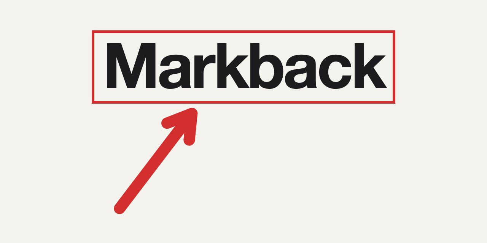
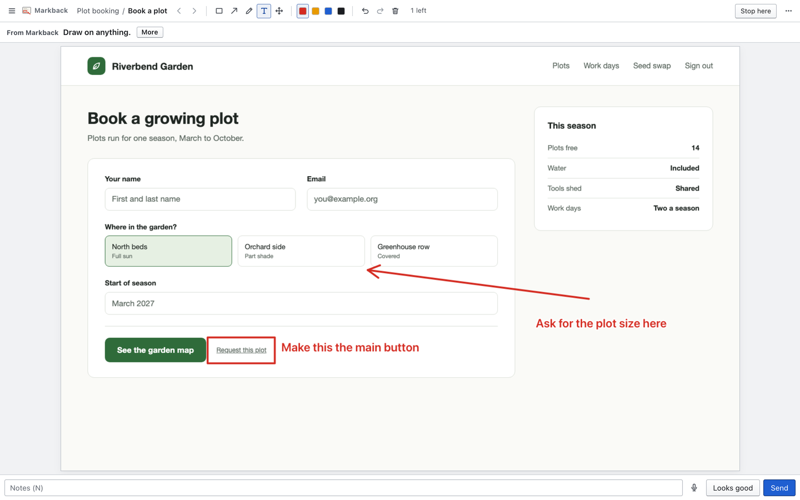
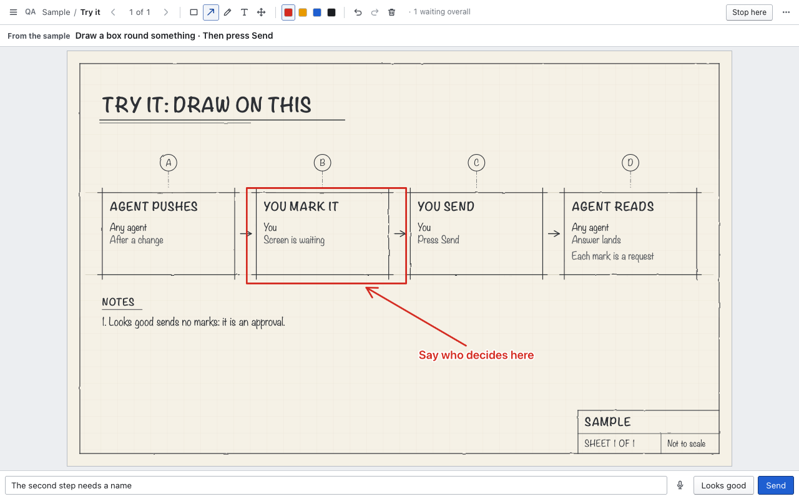

# Markback

**A new way of building apps.**

Home page and film: https://pure.science/markback

Developed by Adam Hyde. © 2026 [Pure Science Inc.](https://pure.science)

1. Models already know a lot about the application you mean: a simple command gets you far.
2. Agents can infer the back end from what the front end needs.
3. Building apps isn't prompting; it's annotating.
4. Voice is a tool: you can say it.

The first two are your own agent's work, such as Claude Code or Codex: it builds, it infers, and it pushes screens. The third and fourth are Markback's: you box, point and write on the screens, or say it, and press Send. Voice is new: point and speak puts your words where you point, and the mic fills the notes. It has not yet been tried with a real voice. The marked picture and the marks as numbers land in a folder your agent reads, and each mark becomes a request.



**Workflows too.** Ask your agent for a workflow, and it draws it as a simple sketch: each step, who may do it, and what makes it happen. Mark up the sketch to change how the app works, as you would a screen.



## Start with your project

You need [Node](https://nodejs.org) 22.6 or later. Markback uses Chrome or Edge for screenshots. Inside Codex's macOS sandbox it needs a small browser of its own, fetched once: your agent asks you before it fetches it.

### Start from chat

Open your project in a local Claude Code or Codex session and ask in the chat.

> Set up Markback from https://github.com/esetera/markback for this project. Open the first review and keep sending screenshots to Markback as you work.

Your agent runs the setup and opens the review. As it reaches a visible change, it pushes the updated screenshots and waits for your feedback. You can draw and press **Send**, or press **Looks good**.

### Codex Desktop without a terminal

Open your project in Codex Desktop and paste this into the project chat:

> Set up Markback from https://github.com/esetera/markback in this project. Open the first review and turn on automatic pickup of my marks in this chat.

Codex installs Markback locally, starts the review, and sets up a scheduled check in the same chat. Draw on a screenshot and press **Send**. Keep Codex Desktop open. On the next check, usually within a minute, the chat picks up the mark even if its first turn has finished. Codex applies the change and pushes a new screenshot for review.

In a fresh Codex project, the agent can use `npm install --prefix .markback github:esetera/markback` to install locally and read `.markback/node_modules/markback/AGENTS.md` in the current session. The agent keeps `REVIEW_HOME` in a writable project folder and uses that same folder for each review command. `review project` can start the review even when Codex protects `.agents/skills` from edits.

### Manual installation

**Claude Code**

```bash
claude plugin marketplace add esetera/markback && claude plugin install markback@markback
```

Then, in your project, type `/markback`.

**Codex**

```bash
npm install -g github:esetera/markback && review install-skills --codex
```

Run it in your project's folder. Then ask Codex: review my app.

**Kimi Code**

```bash
git clone https://github.com/esetera/markback ~/markback
```

Then, in your project's folder:

```bash
kimi --skills-dir ~/markback/skills
```

Then ask Kimi: review my app. For that run, Markback's skills stand in for your others. To go back into a session, add `-S` to pick one, or `-c` for the latest in this folder: `kimi --skills-dir ~/markback/skills -S`.

To keep your other skills, put Markback's where Kimi Code already looks, and start it with plain `kimi`. `node ~/markback/review.mjs install-skills` writes them to `~/.agents/skills`; run it again after you update Markback. Or add `extra_skill_dirs = ["~/markback/skills"]` to Kimi Code's `config.toml`.

Other agents that can run commands should work too: CodeWhale is next to be tried.

Markback finds how your app runs, starts it if you say yes, takes pictures of its main screens and opens them in your browser: draw on what you want changed, and press **Send**. No app yet? Say what you want, for example `/markback a recipe box for my family`.

### Review beside your code

In a local desktop session your agent opens the review for you. If it cannot, open the review URL it gives you. Markback uses `http://localhost:5741` by default.

- **Claude Code Desktop.** Open the Browser pane from the session toolbar and enter the review URL. [Claude Code browser docs](https://code.claude.com/docs/en/desktop#preview-your-app)
- **Codex desktop.** Open the built-in browser from the toolbar and enter the review URL. You can also ask `@Browser` to open it. [Codex browser docs](https://learn.chatgpt.com/docs/browser#preview-a-page)

Draw with Markback's tools and press **Send**. The local server saves the marked screenshot, notes and mark coordinates. [Codex Desktop's scheduled check](#codex-desktop-without-a-terminal) picks up the feedback in the same chat. Other agent sessions can wait for a round with `review wait`, apply the feedback, and push new screenshots.

The same URL works in a regular browser on that computer. For voice notes, use Google Chrome if the built-in browser can't transcribe. See [Speaking](#speaking-early) for browser support and where the audio goes.

## Try it without a project

```bash
git clone https://github.com/esetera/markback
cd markback
node review.mjs start
node review.mjs demo
```

Open the address it prints, draw on the sample, and press Send. Then read what came back:

```bash
node review.mjs read --app Sample --latest
```

Or show any running app, ready to mark: `node review.mjs see http://localhost:3000`.

If the port is taken: `node review.mjs start --port 5742`. To stop: `node review.mjs stop`.

## Your agent

Markback is a command and plain files, so it works with any agent that can run a shell command. What it teaches agents lives in five skills: `markback`, `push-screens`, `read-marks`, `workflow-sketches` and `ideas-and-queue`. Everything below is made from those same five files, so no agent is taught something different.

**Claude Code**, in one step. It gives every session the `review` command and the five skills. Try `/markback` in a project, or `/markback a recipe box for my family` in an empty folder. If another command already has that name, `/markback:markback` always works.

```bash
claude plugin marketplace add esetera/markback && claude plugin install markback@markback
```

**Codex and Cursor** read skills from `~/.agents/skills`. From the cloned folder:

```bash
node review.mjs install-skills
```

Run it again after you update Markback. To put it in one project only, add `--to <project>/.agents/skills`; `markback` (and `/markback`) does that for the project it runs in.

**Codex**, in a project with the skills in `.agents/skills`:

```bash
codex exec -s workspace-write "Here is a screen I want reviewed: shot.png. Put it in front of me for review."
```

For local projects inside Codex's macOS sandbox, Markback takes pictures with Chrome Headless Shell, about 100 MB from Google, fetched once and kept on this computer. Nothing is fetched until you say yes: the first capture stops and tells the agent to ask you, and after your yes the agent runs it again with `--fetch-browser`. The download needs network access. This capture path is for local pages and assets. An agent with a built-in browser can also capture a page there and push the screenshot to Markback.

**Kimi Code** reads the skills straight from the cloned folder with `--skills-dir`, in place of your others for that run: `kimi --skills-dir ~/markback/skills`, with `-S` or `-c` to go back into a session. It also reads `~/.agents/skills` and `extra_skill_dirs`, which keep your others. See [Manual installation](#manual-installation).

**Any other agent** that reads `AGENTS.md` (Codex and Cursor do, and others): add Markback's part to your project's `AGENTS.md`. It goes between two markers, so your own words stay and a rerun replaces only that part. It names where your Markback folder is; add `--no-path` to say it in words instead, for a file you commit.

```bash
node review.mjs install-skills --agents-md /path/to/your/project
```

`npm install -g .` from the cloned folder puts `review` on your PATH. Without that, agents use `node /path/to/markback/review.mjs`, and the skills say so, both in the folder and when installed.

**Full review workflow tried with Claude Code, Codex and Kimi Code.** What was run: Claude Code, with the plugin, including `/markback` in a project from a cold start. Codex, with the skills in `.agents/skills`, and Kimi Code, with `--skills-dir`: each pushed a screen, read the marks and acted on them, pushed round 2, and drew a sketch. A second Claude Code run with no plugin and no skills, which knew Markback only from `AGENTS.md`: it pushed a screen, and after a box and a note came back it read them and said where they were. A plain script that runs only the commands `AGENTS.md` shows, which is part of `npm test`. Cursor compatibility is based on its documentation.

## Plugins

A plugin adds a command to `review`, or a new way to export an app's marks. The first one turns marks into a Markdown checklist for an issue or a pull request:

```bash
review plugin add https://github.com/esetera/markback-plugins
review export --app "My app" --as markdown --out marks.md
```

Adding one says what it adds and asks first (in a terminal; run any other way, it needs `--yes`). Plugins run code on your computer, so add only ones you trust. `review plugin list` shows them; `review plugin remove <name>` takes one away. To write your own, see [markback-plugins](https://github.com/esetera/markback-plugins).

## What stays on your computer

The Markback server listens only on this computer. Screens, marks and notes are plain files in `~/.review-wizard`, a folder that keeps Markback's first name (set `REVIEW_HOME` to move it). Your coding agent handles any review material it reads under its own data settings. If you enable online speech recognition, your browser sends the audio to its speech service.

## Speaking (early)

For voice notes, start with Google Chrome and allow the microphone for the review page. Other browsers can offer speech recognition, depending on their permissions and speech service. Markback's automated tests simulate speech recognition; it has not been tried with a real voice yet. Press **D** to speak your notes. The page shows which speech service it will use.

| Browser | What happens |
| --- | --- |
| Chrome | On this computer. The first press fetches a language pack of about 60 MB from Google, once, if you agree. |
| Safari, Edge, or Chrome with no pack for your language | The browser sends the sound to its maker: Apple, Google or Microsoft. It stays off until you turn it on, and the button says so. |
| Firefox | Speech recognition is off by default. Use typed notes and drawing, or open the review URL in Chrome for voice notes. |
| Others, or a window with the microphone blocked | No microphone: it says to open the page in Chrome. |

**Speak at a spot** (the speak tool in the bar, or **D**): click on the picture and say it. A pin with a microphone lands where you clicked, a ring round it shows that it listens, and your words are written in a box beside it. Click somewhere else for the next pin; **Esc** or a pause ends one. Each pin goes to your agent as what you said and where. The microphone at the foot (**⇧D**) only fills the notes box.

A phrase that is only "looks good", "next", "back", "send" or "stop listening" acts. Any other words go to the pin that listens, or to the notes when none does, and you can correct notes as you go.

## The review page

Light and dark are separate screens. The page is the review: the picture fills the window, fitted so nothing is cut off. A tall picture that would be a narrow strip, a page of a PDF in a small window or a whole long web page, is shown a page wide and scrolls; **0** shows the whole of it.

- **One thin bar:** the app and screen, "3 of 13", back and next, the marking tools, Before and After when there is a before, and a small menu.
- **What to look at:** one line, in ten words or fewer as pushed. It is the first sentence of the note, or the `--check` lines, three at most; **More** (I) opens the rest over the picture, so the picture does not move. When a fitted picture leaves room at its side, the lines stand there, level with its top, and never make it smaller.
- **Where it changed:** with a before of the same size, corner ticks mark each place that differs. They show on screen only and never in what is sent. C hides them. They do not show when most of the picture changed, and a very faint change can go unmarked.
- **All the screens:** the count in the bar ("4 left", or **O**) opens every screen of the review with where each stands. A press goes to one, and **Looks good for the rest** answers what is left.
- **Select words:** where a picture came with a word list, the words tool (**E**) marks the words themselves, as in a document. Without a list it draws a box.
- **Something new:** the tab's title counts what waits. New screens are said on the page, and from behind another window by a sound and, if you allow it, a notice. The menu turns the sound and notices off.
- **New project:** in the menu, the same two ways in as the first screen: a running app's address, or `/markback` in your agent, with one sentence after it when there is no app yet. The new project stands beside the ones there, which are left as they are. An address that is already a project makes its next round, and the page says so. **Esc** closes the window; a picture still being taken goes on, and the page says when it is ready, with a way to go there.
- **At the foot:** a slim notes box that grows up over the picture as you type, Looks good and Send. If there are answers already, a small line opens them.

Opened at the plain address it starts at the next thing to review, not set aside, says where with one press to be in, and the list and panels stay out of the way. A link with a `#` opens what it names.

Draw by dragging. The last tool and colour stay. Keys for the rest: press **?**.

**Looks good** (G) and **Send** (⌘Enter) go straight on. The next pictures are already loaded, so the swap is instant, and Back is as quick. A small note says what happened, with **Undo** (U) for four seconds. Then the answer goes to the inbox by itself. Marks and notes stay in the browser until they have gone, so closing the window loses nothing: a Looks good goes as it closes, and marks and notes go on the next look, which says so in one line. If the server is away they are kept and go when it is back.

An answer belongs to the picture it was given on. If a new picture is pushed before it has gone, a Looks good is dropped and says so (the new picture still waits), and marks and notes go to the inbox flagged `olderPicture`, with the screen still waiting. A draft saved on some other picture never goes by itself: a Looks good on it is forgotten, and its marks and words stay in view until you press Send.

Moving into another review is never quiet. A full overlay says what was finished and what is starting, and stays until a press: **Enter** starts, **X** sets the rest of the group aside, **S** stops. G does nothing there, however fast or held. A change of group is larger than a change of app. Marks you moved past without sending go with the rest, so there is no last step. When nothing is offered, a plain page says so.

**Groups:** apps named "X-style: title" or "X: title" with more than one member show as a group: "Alpha, 2 of 5". What is stored and pushed does not change. The bar keeps count: "this one 2 of 5 · 12 waiting overall".

**Stop here** (S, or the bar) can be pressed at any time. What you answered goes at once, and the page says what is sent, what waits and how to go on. **Set aside** (from the overlay, the list or the menu) answers nothing and sends nothing: it only stops an app being offered, kept beside the queue in `queue/set-aside.json`. A new round on it stays set aside, and says it is new. One press brings it back. **Looks good for the rest** (⇧⌘Enter, or the menu) answers all that is left at once, and those with nothing on them are recorded as no comment.

**L** opens a slim drawer over the picture. Groups, reviews and their pages all fold: click a heading, or Right and Left. All start closed, with an outline on the heading that holds where you are. A heading shows its counts. **Open** goes to a review, and the drawer closes on choosing. **Q** is the panel view: a strip and the details beside the picture, each can be folded from the menu, and the picture keeps at least 70%. **Esc** closes what is open or cancels a mark being drawn, and never loses words.

## Keys (press ? in the page)

| Key | Does |
| --- | --- |
| ← → | Previous or next screen |
| [ ] | Previous or next app |
| Enter | On to the next app, at the end of one |
| L | Apps and screens |
| O | All screens of this review, and where each stands |
| V | After, side by side, before |
| C | Show or hide where it changed |
| I | The rest of the words |
| Q | Panel view |
| F | Full screen |
| B A P T M | Box, arrow, pen, text, move |
| D | Speak at a spot: click on the picture, then say it |
| ⇧D | Speak your notes into the notes box |
| E | Select the words themselves, where the picture has a word list |
| 1–4 | Red, amber, blue, black |
| ⌘Z / ⇧⌘Z | Undo / redo a mark |
| + − 0 | Zoom in, zoom out, fit. On a tall picture, 0 again shows the whole of it |
| N | Write notes on this screen |
| G | Looks good, and on to the next |
| ⌘Enter | Send, and on to the next |
| U | Undo the last answer, while it says so |
| ⇧⌘Enter | Looks good for all the rest |
| Esc | Close or cancel. Words stay |

## Push screens (the session that made the change)

```
review push --app MyApp --screen Home --mode light \
  --after /path/after.png --before /path/before.png --note "What changed" --check "One thing to check" --check "Another" --from "Claude"
```

Say what to look at in ten words or fewer. Longer words wait behind More, and `push` warns. `--check` can be said more than once. `--from` says whose words the note and checks are, shown as "From Claude" beside them; it defaults to Claude.

The pictures are copied, so scratch files can go away. Pushing the same app, screen and mode again starts round 2 on
the same step.

### A PDF

```
review pdf brochure.pdf --check "Is the cover right?"
```

Each page becomes a screen to mark: a brochure, a paper, a slide deck saved as a PDF. It shows the first 30 pages; ask for others with `--pages 31-60`. Push it again after a change and each page starts round 2, with where it changed marked. On a Mac it needs nothing more. Anywhere else it needs `pdftoppm`, which comes with [Poppler](https://poppler.freedesktop.org).

### The words under a mark

A screenshot is only pixels, so a box says where and not what. When a picture comes with a list of its words, each mark carries the words under it. `review see`, `review project` and `review pdf` make the list as they take the picture. For your own screenshot, make the list in the page and push it too:

```
review words-script                # a script to run in the page with a browser tool: its value is the list
review push --app MyApp --screen Home --after after.png --words after-words.json
```

The list is `{ "size": { "w": 1440, "h": 900 }, "words": [{ "t": "Saturday", "x": 795, "y": 1038, "w": 132, "h": 34, "el": "div.item > b" }] }`: each word with its box in the picture's own pixels, in reading order, and `el`, the element it is in, where there is one. Markback does not read words off a bare picture: a screenshot pushed without `--words` has no list, and its marks carry no words. The page script reads the text the window shows and what its form fields show (never a password); it leaves out frames, closed shadow roots and text a style sheet adds (`::before`).

## Read the feedback

```
review wait --app MyApp --all     # blocks until every screen is answered, then prints them
review wait --app MyApp           # returns as soon as one screen is answered
review read --app MyApp --latest  # what was said, newest per screen; --json for raw
review list                        # what is queued and its status
review work wait --by "Claude"     # blocks until anything waits for an agent, on any app or in the queue
review clear --app MyApp          # take the app off the page (feedback stays)
```

Inbox: `~/.review-wizard/inbox/<app>/<screen>-<mode>-<time>.{png,json}`. The JSON:

```json
{
  "app": "MyApp", "screen": "Home", "screenId": "home-light", "mode": "light", "round": 1,
  "verdict": "changes",
  "notes": "The heading should line up with the button.",
  "shapes": [
    { "type": "box", "colour": "red", "box": { "x": 100, "y": 80, "w": 120, "h": 50 } },
    { "type": "arrow", "colour": "red", "box": { … }, "from": { "x": 400, "y": 700 }, "to": { "x": 800, "y": 300 } },
    { "type": "text", "colour": "red", "box": { … }, "text": "Make this bigger" },
    { "type": "freehand", "colour": "red", "box": { … }, "points": [[x, y], …] },
    { "type": "pin", "colour": "red", "box": { … }, "at": { "x": 620, "y": 210 }, "n": 1, "text": "The title should be bigger" }
  ],
  "imageSize": { "w": 1290, "h": 835 },
  "annotatedImage": "…/inbox/myapp/home-light-….png",
  "afterImage": "…/images/myapp/home-light-after-….png",
  "beforeImage": "…/images/myapp/home-light-before-….png",
  "sentAt": "2026-01-15T14:57:17.701Z"
}
```

`read --latest` and `wait --all` give one record per screen. When marks are sent twice on one picture, each marked copy holds only what was new, so the newest record carries the ones before it under `earlier`. A Looks good pressed over changes replaces them and stands alone.

When the picture came with its words, a mark has `"words"`, as one line, 200 words at most. A box has the words that are at least half inside it. A freehand line has the words it runs through or under, and a loop the words inside it. An arrow has the one word nearest its head. When those words are all in one element, the mark has `"element"` too, such as `"div.item > b"`. A mark of type `words` is words the reviewer chose, in `"text"`. `review read` says them: `1. box (red) at x 781, y 1001, 351x116, on the words "First work day Saturday 14 March"`.

Every `box` is in the after picture's own pixels. `verdict` is `changes` or `approved` (approved has no shapes and no
annotated image). A screen sent with the set with nothing on it is `approved` with `"notes": "No comment."` and an extra
`"noComment": true`: it counts as Looks good, and the flag keeps it apart from a Looks good pressed on that screen.

The page also reads `GET /api/history?app=<app>&id=<screen id>` (earlier answers for one screen) and
`GET /inbox/<app>/<file>.png` (the marked pictures). Both only read.

## Ideas and the queue

Press **W** for a second page. **Ideas:** say what for and how many, and press Get ideas. That writes a request; an agent studies the thing and answers. Each idea is one line for what, one for why, and a size. Press Yes, No or Later (Y, N, L).

**Queue:** Queued, In progress, Ready for you, Done. Each item says who has it. Drag to set the order, or use ⇧↑ and ⇧↓; agents take the top one first. Press N to add a note, typed or spoken; agents read notes while they work.

A Yes becomes a proposal: an agent develops the UX and pushes it, shown loudly as **Proposal**. Marks start another round. Your approval moves it to **Build it**, and what gets built comes back for checking as **QA**. For the commands, run `review` or see the skills.

### When nobody is listening

Approved work must not wait unseen. An agent says that it listens while it waits (`review work wait`, `review wait`): it checks in every few seconds, and the server knows when it last did. While an agent listens, or nothing waits, the page shows nothing about it: there is nothing for you to do.

When you approve a proposal, or send marks, and no agent listens, the page says so at once: "Approved. No agent is listening, so nothing will be built yet." The notice stays until you close it or an agent listens. While work waits and no agent has checked in for 15 seconds, the bar of the review page and of the queue says **No agent is listening** (or **Not heard yet**, when an agent listens for something else), and the review page's tab title starts with `!`. Point at it to see how to start one. While Markback starts your agent for you, it says **Waking your agent…**. The queue shows how long each item has waited. When an agent does listen, you see one quiet line: "Claude is listening and will take this."

The notice gives one line to copy for your agent:

```
Take the next item from the Markback queue and build it.
```

For an agent: `review work` prints all that waits (queued items, requests for ideas, answers nobody has read) with the next command for each. `review work wait --by "Claude"` blocks until there is something.

### Markback wakes your agent

In **Codex Desktop**, ask Codex to set up automatic Markback pickup in the chat. Codex starts Markback as part of opening the review and sets up a scheduled check in that chat. After you press **Send**, the next check reads the marks and Codex pushes the revised screen. Keep the desktop app open while reviewing. The review menu can turn pickup off for this review.

#### Claude Code and other command-based agents

You should not have to give that line. Your agent says once how to start it, and the review page's server does the rest:

```bash
review wake set --run "claude -p '{prompt}' --continue" --by "Claude"
```

The skills tell the agent to run this itself during setup, in your project's folder. There is one command for each project: setting it in one project never changes another's. About every 20 seconds the server looks at each project's work: the queue items, requests for ideas and marks on the reviews that project pushed. When such work waits and no agent has listened for a minute, it runs that project's command in its folder, with `{prompt}` replaced by a fixed prompt that names the project and its reviews and says to run `review work`, which in that folder lists only that project's work. Work on a review that no project with a command has pushed wakes nobody. It runs one at a time, rests 30 seconds after each run, and does not run again for the same work within ten minutes. What the run prints goes to a log for that project under `~/.review-wizard/work/wake/`. A run is known by its process, also after the server restarts. A run that goes on for 30 minutes no longer stops a new one, and the page says so. The page says "Waking your agent…", then that it listens. If the run fails, the page says so, with the last line of the log and the line to copy.

- The command is set only from the command line. The page can turn wake on and off (menu: **Wake my agent when work waits**) and shows the exact command. It cannot set or change the command, and neither can anything else that reaches the server.
- The woken agent runs with the permissions you already gave that tool. Markback adds none, and passes no flag that skips permission prompts.
- `review wake` shows this project's command, and `review wake --all` every project's. `review wake off`, `review wake on` and `review wake clear` change this project's. The page's menu turns the wake of the review's own project on and off.
- The line above is for Claude Code (a run with no window that continues the last conversation in the folder). For another command-based tool, use its own command of that kind.

### Claude Code hooks

The Claude Code plugin has two hooks. When Claude is about to stop in a project that uses Markback, the Stop hook looks at what waits: if there is work for an agent, Claude is told to take it and does not stop; if nothing waits and no `review work wait` runs, Claude is told once to start one. When a session starts, Claude is told what waits. They only hold Claude for work on that project's own reviews. A project is its folder or its repository's root, where `review project`, `review push` or `review wake set` was run; a folder that merely sits under one is not. In any other folder the hooks do nothing. To turn them off, set `MARKBACK_HOOKS=off` in the environment, for example under `env` in your Claude Code settings.

The hooks are quick: they read a few small files and ask no server. They never hold Claude back while the review page is not running. They cannot loop: they never hold Claude twice for the same reason, hold it again only when the next item waits, stop after ten holds in a row, and let it stop once the queue is empty.

Using Claude Code without the plugin? Put the same hooks in a project's `.claude/settings.json` with `review install-skills --hooks <project folder>`, or in your own settings, for every project, with `--hooks ~`. Your other settings and hooks are kept, a symlinked settings file stays a link, and its mode stays as it was. `review install-skills --remove-hooks <folder>` takes out only Markback's. With `review` on your search path the hooks run `review`; otherwise they name the Markback folder, so run it again if you move that. With both the plugin and these hooks, each check answers once.

## Keeping it working

### On your computer

```bash
review check
```

It proves Markback works here, and says plainly what is missing. It runs a whole round against itself: it starts a review page of its own, pushes a picture, sends an answer as the page does, and reads the answer back. It does this in a folder and on a port of its own, and removes both after. Your own screens and review page are not changed.

- `failed`: Markback cannot be relied on here. The line says what to do.
- `missing`: one part does not work. Without Chrome or Edge, `review project` and `review see` cannot take pictures; `review push` with your own screenshots still works. Without `pdftoppm`, `review pdf` does not work on Linux or Windows.
- `note`: whether your own review page is running, and where. Speaking cannot be checked from a command.

It ends with 0 unless a line says `failed`. `review check --json` gives the same as a list of `{ name, ok, required, words }`, where `ok` is `null` for a note.

### The code

```bash
npm test
```

The browser tests borrow Playwright from any project that has it: `REVIEW_PLAYWRIGHT_FROM=/path/to/package.json REVIEW_CHROME=/path/to/chrome npm test`. Without them they are skipped.

`public/annotate.js`, the drawing code, is also kept in TypeScript in a project that is not public. Edit `public/annotate.js` here as you would any file; the maintainers carry changes across with `scripts/vendor-annotate.mjs`.

Tried on macOS. It uses only Node's own parts and should run on Linux and Windows; those are not yet tried.

## Who makes it

Markback is developed by Adam Hyde. © 2026 [Pure Science Inc.](https://pure.science)

It is open source under the MIT licence (see `LICENSE`). That means you may use it, change it and share it, for any purpose, including in paid work, as long as the copyright notice and licence go with your copies. It comes with no warranty.

Questions, ideas or want to work with us: Adam Hyde, adam@pure.science.

---

[pure.science](https://pure.science)
